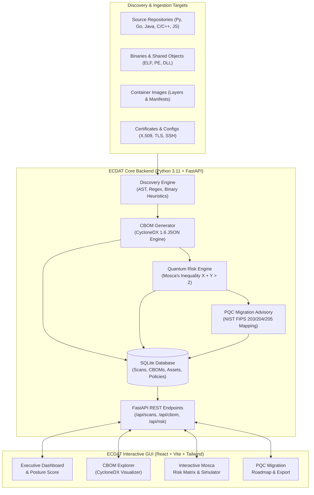

# ECDAT - Enterprise Cryptographic Discovery & Analysis Tool

> **Threws Odyssey 2026 Hackathon — Cybersecurity Track**  
> An automated enterprise platform to discover cryptographic assets, generate CycloneDX 1.6 Cryptographic Bill of Materials (CBOM), assess quantum vulnerabilities via Mosca's inequality, and plan Post-Quantum Cryptography (PQC) migrations.

---

## 📌 Executive Summary & Problem Statement

Organizations worldwide face an imminent cryptographic disruption: the advent of **Cryptanalytically Relevant Quantum Computers (CRQCs)** capable of breaking asymmetric public-key cryptography (RSA, ECC, Diffie-Hellman) via Shor's algorithm. Under the threat of **"Harvest Now, Decrypt Later" (HNDL)**, adversaries are already intercepting and archiving encrypted enterprise and government communications to decrypt once quantum hardware reaches scale.

To transition safely to Post-Quantum Cryptography (PQC), enterprises face three major hurdles:
1. **Cryptographic Blindness**: Lack of visibility into where cryptographic primitives, certificates, keys, libraries, and protocols reside across codebases, binaries, and container images.
2. **Standardized Inventory Deficit**: Inability to generate standard, machine-readable cryptographic asset inventories.
3. **Risk & Migration Ambiguity**: Difficulty quantifying urgency and mapping legacy algorithms to NIST-standardized quantum-resistant replacements.

**ECDAT** solves these challenges by providing automated discovery, standardized **CycloneDX 1.6 CBOM** exports, Mosca's theorem-driven quantum risk scoring, and actionable PQC migration roadmaps.

---

## 🚀 Key Capabilities

1. **Multi-Vector Cryptographic Discovery**
   - **Source Code**: Static analysis of Python, Go, Java, C/C++, JavaScript/TypeScript, and Rust for algorithm usage, cipher suites, key generation, and hardcoded secrets.
   - **Binaries & Libraries**: Symbol table and string extraction across ELF, PE, and shared libraries.
   - **Container Images**: Inspection of base image layers, OS packages, and embedded cryptographic artifacts.
   - **Certificates & Configurations**: Discovery and parsing of X.509 certs, TLS profiles, and SSH configs.

2. **CycloneDX 1.6 CBOM Generation**
   - Native generation of standard **Cryptographic Bill of Materials (CBOM)** compliant with the CycloneDX v1.6 specification.
   - Enriches cryptographic components with algorithm family, primitive type, key length, classical security level, and quantum vulnerability status.

3. **Quantum Risk Assessment via Mosca's Inequality**
   - Formally evaluates risk using Mosca's Theorem:
     $$\text{Risk Alert if } X + Y > Z$$
     - **$X$ (Shelf-Life)**: How long enterprise data must remain confidential (e.g., healthcare, financial records, IP).
     - **$Y$ (Migration Time)**: Time needed to migrate systems to quantum-resistant standards.
     - **$Z$ (Collapse Time)**: Estimated time until a quantum computer capable of breaking the cipher exists.
   - Computes granular **Quantum Vulnerability Indices (QVI)** weighted by asset business criticality.

4. **Cryptographic Asset Classification**
   - Categorizes artifacts by primitive (Asymmetric, Symmetric, Hash, KEM, Signature, MAC).
   - Profiles key lifetimes (ephemeral, short-lived, static long-lived).
   - Maps operational business criticality to prioritize remediation backlogs.

5. **PQC & Hybrid Migration Advisory**
   - Recommends NIST-standardized post-quantum algorithms:
     - **ML-KEM** (FIPS 203 / Kyber) for key encapsulation.
     - **ML-DSA** (FIPS 204 / Dilithium) for digital signatures.
     - **SLH-DSA** (FIPS 205 / SPHINCS+) for stateless hash-based signatures.
   - Guidance on transitional **hybrid schemes** (e.g., X25519 + ML-KEM-768).

6. **Interactive GUI & Dashboards**
   - Real-time scan execution and interactive status tracking.
   - Interactive CBOM explorer with deep filtering.
   - Dynamic Mosca risk simulator with configurable $X, Y, Z$ parameters.
   - Executive posture scorecards and exportable compliance reports.

---

## 🏗️ Planned Architecture



---

## 🛠️ Technology Stack

| Layer | Technology | Purpose |
|---|---|---|
| **Backend Core** | Python 3.11, FastAPI, Pydantic v2 | High-performance async REST API, validation, and core scanning orchestration |
| **Analysis Engines** | Custom AST Parsers, Binary String Extractors, Cryptographic Taxonomy Models | Static discovery, pattern heuristics, cryptographic classification |
| **CBOM Standard** | CycloneDX Python Library / CycloneDX 1.6 Schema | Standardized machine-readable CBOM generation |
| **Risk Modeling** | Custom Mosca's Theorem Engine | Configurable risk modeling ($X+Y>Z$), severity thresholds, and quantum horizon forecasting |
| **Database** | SQLite + SQLAlchemy / aiosqlite | Lightweight, zero-config relational storage for scans, assets, and reports |
| **Frontend UI** | React 18, Vite, Tailwind CSS, Lucide React, Recharts | Fast, responsive enterprise analyst console with interactive graphs and tables |

---

## 📂 Project Structure

```text
ecdat/
├── backend/                  # FastAPI Application & Cryptographic Discovery Core
│   ├── app/
│   │   ├── api/              # REST API routes (scans, cbom, risk, advisory)
│   │   ├── core/             # Configuration, logging, database setup
│   │   ├── models/           # SQLAlchemy & Pydantic models
│   │   ├── scanners/         # Source code, binary, container, and cert scanners
│   │   ├── cbom/             # CycloneDX 1.6 CBOM builder & serializer
│   │   ├── risk/             # Mosca's inequality calculator & risk scoring
│   │   └── advisory/         # NIST PQC replacement rules & recommendations
│   ├── requirements.txt      # Python dependencies
│   └── main.py               # Backend entrypoint
├── frontend/                 # React + Vite + Tailwind CSS Single Page App
│   ├── src/
│   │   ├── components/       # UI widgets, layout, navigation, cards
│   │   ├── pages/            # Dashboard, CBOM Viewer, Risk Simulator, Scans
│   │   ├── services/         # API client bindings
│   │   └── App.jsx           # Main application entry
│   ├── package.json          # Node dependencies & build scripts
│   └── vite.config.js        # Vite build configuration
├── sample_targets/           # Vulnerable and legacy crypto sample apps for testing
├── docs/                     # Architecture diagrams, specifications, presentation materials
└── tests/                    # Backend unit tests and CBOM compliance validation
```

---

## 🚦 Roadmap

- [x] Initial project scaffolding & Git setup
- [x] Backend foundation (FastAPI, SQLite, Pydantic models, and central cryptographic catalogue)
- [x] Multi-vector cryptographic discovery engine (Source AST, Binary, Container, Certificate, Config, and Dependency scanners)
- [x] Ground-truth benchmark suite (`sample_targets/vulnerable_app` with 32 planted artefacts)
- [x] Mosca's inequality risk calculator ($X + Y > Z$), composite 0-100 scoring, and asset classification
- [x] NIST PQC advisory engine (ML-KEM, ML-DSA, SLH-DSA, hybrid schemes, urgency ranking)
- [x] Multi-format export engine (CycloneDX 1.6 CBOM, printable HTML/PDF reports, audit CSV)
- [x] FastAPI REST API with background scanning, zip-slip protection, overrides, and test suite
- [ ] Frontend React + Vite dashboard, interactive CBOM viewer, and Mosca simulator
- [ ] End-to-end integration and automated validation

---

## ⚡ Running the Backend

### Prerequisites
- Python 3.11+
- Virtual environment (recommended)

### 1. Install Dependencies
```bash
pip install -r backend/requirements.txt
```

### 2. Start the FastAPI Server
```bash
uvicorn backend.main:app --reload --host 0.0.0.0 --port 8000
```
Interactive Swagger API documentation will be available at:
`http://localhost:8000/docs`

---

## 📡 REST API Reference

| Method | Endpoint | Description |
|---|---|---|
| `GET` | `/health` | Service health status and version |
| `POST` | `/api/scans` | Start a new scan (accepts zip upload, git repo URL, or local path) |
| `GET` | `/api/scans` | List all historical scans |
| `GET` | `/api/scans/{id}` | Get status and progress of a scan |
| `DELETE` | `/api/scans/{id}` | Delete a scan and its discovered artefacts |
| `GET` | `/api/scans/{id}/artefacts` | Query artefacts (filters: `type`, `risk_level`, `quantum_status`, `is_at_risk`, `scanner`; pagination) |
| `GET` | `/api/scans/{id}/summary` | Comprehensive risk posture scorecard, top 10 riskiest items, and Mosca parameters |
| `PUT` | `/api/artefacts/{id}/override` | Override lifetime, business criticality, or confidentiality shelf life ($X$) |
| `PUT` | `/api/scans/{id}/mosca` | Dynamically update scan Mosca parameters ($X, Y, Z$) and recalculate risk |
| `GET` | `/api/scans/{id}/export?format={cbom\|pdf\|html\|csv}` | Export results as CycloneDX 1.6 CBOM JSON, printable PDF, HTML scorecard, or CSV |
| `GET` | `/api/catalogue` | List all cryptographic algorithms and NIST PQC replacements from the catalogue |

### Example cURL Commands

#### 1. Start a scan on a local directory
```bash
curl -X POST "http://localhost:8000/api/scans" \
     -H "Content-Type: application/json" \
     -d '{"local_path": "sample_targets/vulnerable_app"}'
```

#### 2. Upload a zipped repository
```bash
curl -X POST "http://localhost:8000/api/scans" \
     -F "file=@my_app.zip"
```

#### 3. Retrieve risk posture summary
```bash
curl -X GET "http://localhost:8000/api/scans/<SCAN_ID>/summary"
```

#### 4. Export CycloneDX 1.6 CBOM
```bash
curl -X GET "http://localhost:8000/api/scans/<SCAN_ID>/export?format=cbom" -o cbom.json
```

#### 5. Export Executive PDF Report
```bash
curl -X GET "http://localhost:8000/api/scans/<SCAN_ID>/export?format=pdf" -o report.pdf
```

#### 6. Override artefact criticality and lifetime
```bash
curl -X PUT "http://localhost:8000/api/artefacts/<ARTEFACT_ID>/override" \
     -H "Content-Type: application/json" \
     -d '{"lifetime": "long", "criticality": "critical", "x": 15.0}'
```

#### 7. Update Mosca parameters ($X, Y, Z$)
```bash
curl -X PUT "http://localhost:8000/api/scans/<SCAN_ID>/mosca" \
     -H "Content-Type: application/json" \
     -d '{"y": 4.0, "z": 10.0}'
```

---

## 🧪 Running Automated Tests

```bash
pytest tests/ -v
```
All 70 automated tests cover models, catalogue lookup, all 6 scanners, ground-truth evaluation, Mosca risk scoring, PQC recommendations, multi-format export, and FastAPI REST endpoints.
